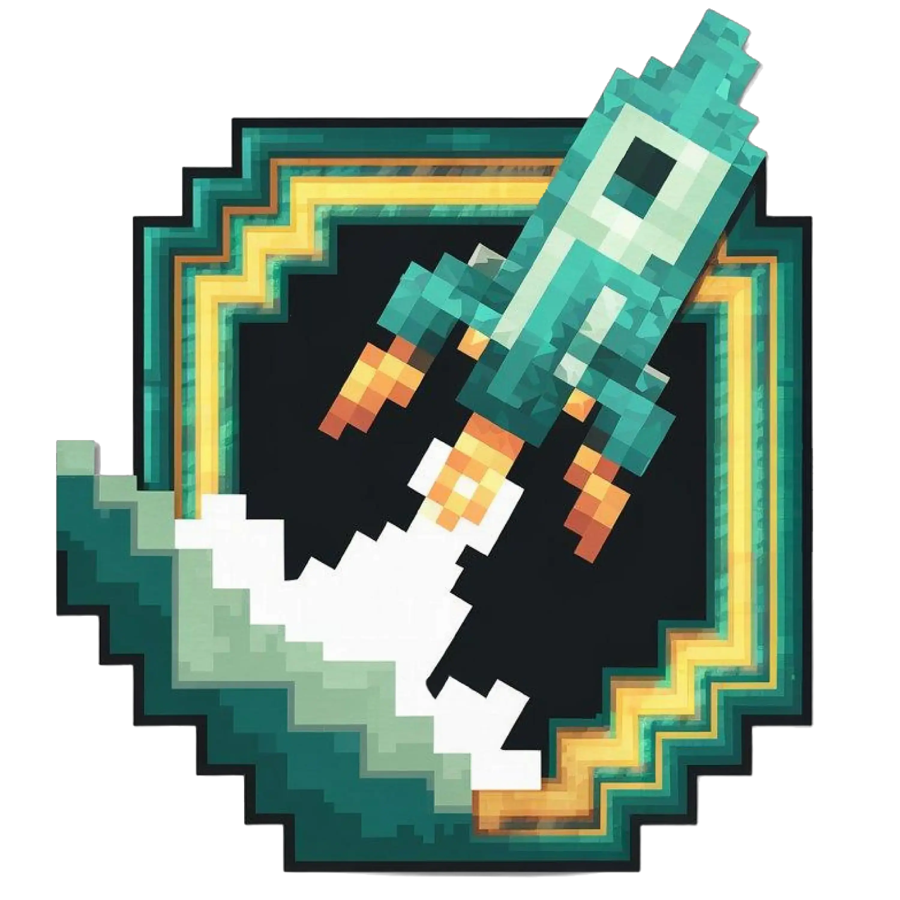

<p align="center">
  
  <h1 align="center">OpenLauncher</h1>
  <p align="center">
    A fast, modern, and open-source Minecraft launcher built with <b>React</b> and <b>Electron</b> for <b>Windows</b>, <b>macOS</b>, and <b>Linux</b>.
  </p>
</p>

<p align="center">
  <a href="https://github.com/CesarGarza55/OpenLauncher/releases"></a>
  
  
  
  
  
  <a href="https://github.com/CesarGarza55/OpenLauncher/stargazers"></a>
</p>

---

## Downloads

Pre-built binaries are available in the **[Releases](https://github.com/CesarGarza55/OpenLauncher/releases)** section:

| Operating System | Installer | Portable | Architecture |
| :--- | :--- | :--- | :--- |
| **macOS** | `OpenLauncher-mac-arm64.dmg` | `OpenLauncher-mac-arm64.zip` | ARM64 (Apple Silicon: M1–M5) |
| **Windows** | `OpenLauncher.exe` | `OpenLauncher-Portable-Windows.exe` | x64 |
| **Linux** | `OpenLauncher.deb` | `OpenLauncher-Portable-Linux.tar.gz` | x64 |

> [!TIP]
> **macOS Installation Note:**
> macOS automatically places downloaded applications from third-party sources into quarantine if they are not signed with a paid Apple Developer certificate. If macOS shows *"OpenLauncher is damaged and can't be opened"*, open Terminal and run:
> ```bash
> sudo xattr -rd com.apple.quarantine /Applications/OpenLauncher.app
> ```

<details>
<summary><b>Legacy Python Version (Beta-1.7.4)</b></summary>

The previous Python-based version of OpenLauncher (legacy) is still available for download in the [Releases](https://github.com/CesarGarza55/OpenLauncher/releases) section. The last version of the legacy system was **Beta-1.7.4**.
The current Electron-based version represents a complete rewrite with improved performance, cross-platform stability, and a modern reactive UI.
</details>

---

## Features

- **Microsoft & Offline Profiles**: Secure authentication via official Microsoft OAuth, plus offline local profile support.
- **Full Instance Isolation**: Create, edit, and launch independent game instances with isolated mods, resource packs, shaders, datapacks, saves, and screenshots. Includes custom icons, custom JVM arguments, and 1-click migration from `.minecraft`.
- **Modrinth Hub (Mods, Shaders & Texture Packs)**: Direct online browsing and 1-click installation of mods, shaders, and resource packs with auto-dependency resolution and update checks.
- **My Library Management**: Dedicated tabs for local Mods, Shaders, Resource Packs, and Data Packs scoped dynamically to the active instance or global `.minecraft`.
- **Fabric Conflict & Incompatibility Auto-Fixer**: Diagnoses Fabric crash logs and harmonizes mod versions in 1 click.
- **Unified Version Installer**: Fast installation of **Vanilla**, **Fabric**, **Forge**, **NeoForge**, and **Quilt** versions with live Minecraft Snapshot support.
- **Fine-Tuned Performance**: Per-profile and per-instance RAM allocation, custom Java paths, and smart version-aware JVM garbage collection presets (Generational ZGC for Java 21+, Aikar's G1GC for Java 8–17).
- **News Feed & Customization**: Integrated official Minecraft news, multi-language support (EN, ES, FR), and auto-updater.

---

## Interface Tour

### Main Dashboard
Quick access to profiles, version selectors, installed mods, real-time console output, official news, and launcher settings.


<details>
<summary><b>View Interface Details & Screenshots (Versions, Settings, Microsoft Login, Mod Manager, Auto-Fixer)</b></summary>

#### Version Installation
Install Vanilla, Fabric, Forge, NeoForge, or Quilt versions with automatic catalog loading and snapshot filters:


#### Settings & Customization
Configure game directories, custom Java JREs, auto-updates, JVM arguments, and language options:


#### Optimized Dynamic JVM Arguments
OpenLauncher dynamically applies the best Garbage Collector flags based on the detected Java runtime:

- **Java 21+ (Modern Minecraft 1.20.5+) — Generational ZGC:**
  ```bash
  -XX:+IgnoreUnrecognizedVMOptions -XX:+UnlockExperimentalVMOptions -XX:+UseZGC -XX:+ZGenerational
  ```
- **Java 8–17 (Legacy / Standard Minecraft) — Optimized Aikar's G1GC:**
  ```bash
  -XX:+IgnoreUnrecognizedVMOptions -XX:+UnlockExperimentalVMOptions -XX:+UseG1GC -XX:+ParallelRefProcEnabled -XX:MaxGCPauseMillis=200 -XX:+DisableExplicitGC -XX:+AlwaysPreTouch -XX:G1NewSizePercent=30 -XX:G1MaxNewSizePercent=40 -XX:G1ReservePercent=20 -XX:G1HeapWastePercent=5 -XX:G1MixedGCCountTarget=4 -XX:InitiatingHeapOccupancyPercent=15 -XX:G1MixedGCLiveThresholdPercent=90 -XX:G1RSetUpdatingPauseTimePercent=5 -XX:SurvivorRatio=32 -XX:+PerfDisableSharedMem -XX:MaxTenuringThreshold=1
  ```

#### Microsoft Account Authentication
Authenticate securely with your official Minecraft-entitled Microsoft account:

1. Open OpenLauncher.
2. Click on the **Microsoft icon** in the sidebar.
3. Complete the login in the secure browser prompt.


#### Mod, Shaders & Texture Packs Manager & Modrinth Browser (Beta)
Browse thousands of mods, shaders, texture packs and data packs check installed mod updates against Modrinth hashes, and drag-and-drop files:


#### Mod Incompatibility Auto-Fixer
When Fabric detects conflicting mods, OpenLauncher parses the diagnostic tree and applies harmonized versions in one action:


#### Instance Creation & Profile Management
Create separate Minecraft instances to run distinct modpacks, loaders, versions, and configurations without interference:
- **Dedicated Game Directories**: Keeps `.minecraft/instances/<id>` fully isolated (mods, config, saves, resource packs, shaders, data packs).
- **Scope-Aware Content Management**: Selecting an active instance automatically shifts your Mods, Shaders, Resource Packs, and Data Packs tabs to that instance.
- **Custom Visuals & Performance**: Pick standard pixel-perfect Minecraft block icons or upload your own custom image (`.png`, `.jpg`, `.webp`, `.svg`), with individual RAM and JVM argument overrides.


#### Instance Migration Wizard
Easily transition from a traditional shared `.minecraft` directory to an isolated setup without losing your progress:
- **Non-Destructive Cloning**: Safely copies existing mods, configs, shaders, resource packs, and world saves into a dedicated new instance.
- **Automatic Loader & Version Detection**: Identifies the currently installed Fabric, Forge, NeoForge, Quilt, or Vanilla environment to preserve modpack compatibility.


</details>

---

## Build from Source

**Requirements:** Node.js 18+, npm/pnpm, Java JDK 17+.

```bash
git clone https://github.com/CesarGarza55/OpenLauncher.git
cd OpenLauncher
npm install
```

<details>
<summary><b>macOS Build Instructions</b></summary>

Execute the macOS compilation script:
```bash
chmod +x compile-mac.sh
./compile-mac.sh
```
Choose Apple Silicon (ARM64), Intel (x64), or Universal to generate `.dmg` and `.zip` packages in `release/`.
</details>

<details>
<summary><b>Windows Build Instructions</b></summary>

Execute the Windows batch script:
```cmd
compile-windows.bat
```
Generates `OpenLauncher.exe` (NSIS installer) and `OpenLauncher-Portable-Windows.exe`. Requires [NSIS](https://nsis.sourceforge.io/Download).
</details>

<details>
<summary><b>Linux Build Instructions</b></summary>

Execute the Linux compilation script:
```bash
chmod +x compile-linux.sh
./compile-linux.sh
```
Generates `OpenLauncher.deb` (Debian/Ubuntu) and `OpenLauncher-Portable-Linux.tar.gz`.
</details>

### Custom Microsoft Entra Client ID (For Forks & Developers)

1. Register an app in [Microsoft Entra ID](https://entra.microsoft.com): **App registrations** &rarr; **New registration**.
2. Add Redirect URI: `http://localhost:8080/callback`.
3. Request Xbox Live & Minecraft scopes ([Microsoft Developer Form](https://forms.office.com/Pages/ResponsePage.aspx?id=v4j5cvGGr0GRqy180BHbR-ajEQ1td1ROpz00KtS8Gd5UNVpPTkVLNFVROVQxNkdRMEtXVjNQQjdXVC4u)).
4. Test OAuth flow in your local environment.

> [!WARNING]
> Never commit client secrets or refresh tokens to a public repository.

---

## Testing & Benchmarks

- **Hardware**: AMD Ryzen 5 5600G (6-core / 12-thread), AMD Radeon RX 580 (8GB VRAM), 32GB DDR4 RAM, Windows 11 Pro x64
- **Setup**: OpenLauncher 1.1.4, 4GB RAM allocated, Minecraft 1.21.11, Fabric Loader 0.1845, Custom Mods (Distant Horizons, Iris, Sodium, etc.)
- **Shaders**: [MakeUp-UltraFast-9.5e](https://modrinth.com/shader/makeup-ultra-fast-shaders)


---

## Why Electron & Zero-Overhead Optimization

OpenLauncher utilizes **Electron + React 19** to deliver a unified, cross-platform experience across macOS, Windows, and Linux—featuring fluid animations, instant Modrinth hub discovery, and secure Microsoft OAuth flows.

Rather than letting Chromium consume unnecessary memory while you play, OpenLauncher is engineered specifically for maximum performance and resource efficiency:

### 1. Zero-Overhead Mode
When set to **"Close launcher completely"**, OpenLauncher terminates Electron entirely upon starting Minecraft, freeing **100% of its RAM** for your game. A native OS background supervisor (`/bin/sh` on macOS/Linux, PowerShell on Windows) monitors the game's PID with near-zero overhead (< 2 MB) and automatically relaunches OpenLauncher the moment Minecraft closes.

### 2. Background Throttling & Memory Cleansing
In **"Hide launcher"** mode, the application window is hidden, audio is muted, Chromium background throttling is enforced, and session memory caches are cleared to minimize background footprint.

### 3. Modular Decoupled Architecture
- **Vite & React 19**: Ultra-fast hot-module reloading and optimized production bundles.
- **Context-Isolated Preload Bridge**: Secure, minimal CommonJS IPC layer (`electron/preload.cjs`).
- **Dedicated Background Services**: Separated modules for game launching, Java detection, content downloads, and mod conflict diagnostics.

### 4. Built-in Benchmark Suite
Measure and verify resource usage on your machine in real time with our automated testing suite:
```bash
pnpm run test:perf
```

---

## Contributing & License

Contributions are welcome! Please open issues or submit pull requests following standard GitHub workflows.
This project is licensed under the **[GPL-2.0 License](https://github.com/CesarGarza55/OpenLauncher/blob/main/LICENSE)**.

---

## Credits & Acknowledgements

OpenLauncher is developed and maintained by **[Cesar Garza](https://github.com/CesarGarza55)** with modern AI-assisted engineering workflows for rapid feature iteration and code quality. Built upon [Electron](https://www.electronjs.org/), [React](https://react.dev/), [Vite](https://vitejs.dev/), [Node.js](https://nodejs.org/), [electron-builder](https://www.electron.build/), and [Modrinth API](https://docs.modrinth.com/).

---

## Disclaimer

This project is not affiliated with Mojang AB or Microsoft. Minecraft is a registered trademark of Mojang AB and Microsoft. Review the [Terms and Conditions and Privacy Policy](https://openlauncher.codevbox.com/terms) or contact [support@codevbox.com](mailto:support@codevbox.com).
